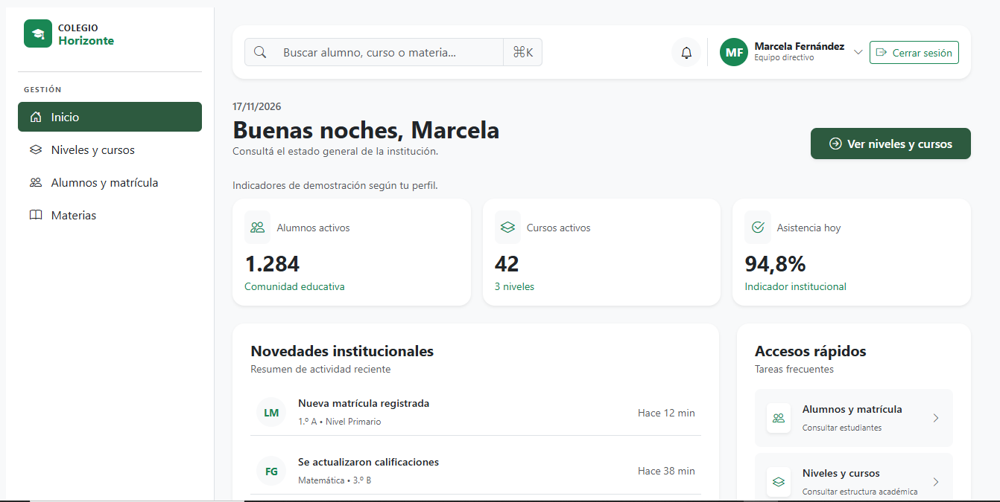
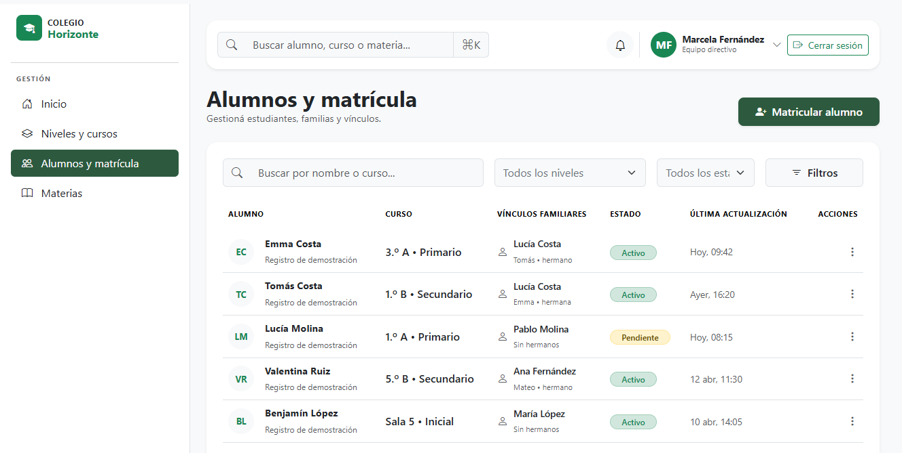

# Trabajo Práctico: Diseño y Desarrollo Web Escolar

## Datos del alumno

- **Alumno:** Cristian Fernando Barrios
- **Carrera:** Tecnicatura Superior en Desarrollo de Software
- **Materia:** Programación Web
- **Profesor:** Lic. Gabriel Artaza
- **Tema:** Colegio Horizonte

---

## Estructura del monorepo

- `landing-escuela/`: sitio estático institucional correspondiente a los Trabajos Prácticos N.º 2 y N.º 3.
- `web-app-escuela/`: aplicación PHP del Trabajo Práctico N.º 4, con modularización SSI, renderizado SSR, roles, sesiones y variables de entorno.
- `assets/`: carpeta de la raíz destinada a las capturas y evidencias visuales de los trabajos prácticos.
- `index.html`: página de entrada de la raíz que redirige a la portada del sitio estático.

---

## Trabajo Práctico N.º 1: Análisis y Wireframes

El primer trabajo consistió en documentar la elección del tema, los intereses institucionales, los sitios de referencia, el wireframe y el mapa del sitio.

  - [Ver documento completo del TP1 en Google Docs](https://docs.google.com/document/d/1velZkvVOvjWmc1mu0CTUjcVx32MY78nxgrrS2tAsLbg/edit?usp=sharing)

### Wireframe base


---

## Trabajos Prácticos N.º 2 y N.º 3: Diseño UI/UX y Maquetación Estática

El Trabajo Práctico N.º 2 definió la interfaz visual y el Trabajo Práctico N.º 3 llevó la propuesta a una maquetación estática dentro de `landing-escuela/`.

- [Ver diseño completo del sitio en Figma](https://www.figma.com/make/8HDHTztRUUtWocPcrxmL1h/Educational-School-Website-Design?t=oX5nv12SgkgjRwFn-1)

<details>
<summary>Capturas de las secciones institucionales y educativas</summary>

### Inicio


### Autoridades


### Quiénes somos


### Misión, visión y valores


### Documentos institucionales


### Nivel inicial


### Nivel primario


### Nivel secundario


### Pastoral y comunidad


### Novedades y noticias


### Admisión e inscripciones


### Contacto y ubicación


</details>

---

## Trabajo Práctico N.º 4: Migración a PHP, Modularización SSI y SSR

El cuarto trabajo práctico migra el diseño institucional a una aplicación PHP dinámica. La implementación se encuentra en `web-app-escuela/` e incorpora navegación responsive, autenticación simulada, sesiones, permisos por rol y vistas específicas según el perfil activo.

- [Ver prototipo de Figma de la Web App](https://www.figma.com/make/2ig7GnsxnjOj469BCJFGmH/Gesti%C3%B3n-Escolar-Colegio-Horizonte?code-node-id=0-6&p=f&t=rzOjt53aobRP2h6F-0&fullscreen=1)

### Tecnologías utilizadas

- HTML5
- CSS3
- Bootstrap 5
- Bootstrap Icons
- JavaScript
- PHP 8.x
- XAMPP y Apache
- Variables de entorno mediante `.env`

### Arquitectura modular

- `index.php` funciona como enrutador principal. Verifica la sesión y dirige al dashboard o al login.
- `login.php` contiene el formulario de acceso simulado y permite probar los roles disponibles.
- `logout.php` limpia la sesión y elimina su cookie antes de redirigir al login.
- `dashboard.php`, `alumnos.php`, `niveles.php`, `materias.php` y `hijos.php` son vistas protegidas por el guard de autenticación.
- `includes/header.php`, `includes/footer.php` e `includes/nav.php` forman el sistema de SSI compartido.
- `includes/auth.php` y `config/roles.php` definen la identidad, los permisos y los datos demostrativos de cada perfil.
- `config/env.php` centraliza la lectura de variables institucionales.
- El sistema muestra una barra lateral clásica en escritorio y un menú off-canvas en dispositivos móviles.
- Los títulos de cada vista se definen antes de incluir el header, permitiendo renderizado SSR con metadatos personalizados.

### Roles implementados

- **Admin:** acceso general a la gestión institucional.
- **Directivo:** consulta global de alumnos, niveles y materias.
- **Preceptor:** acceso a alumnos y niveles/cursos asignados.
- **Profesor:** visualiza en `materias.php` únicamente sus cátedras individuales.
- **Tutor:** accede a **Mis Hijos** (`hijos.php`) para consultar cursos, asistencias y promedios demostrativos.

Las cátedras se representan como registros individuales de materia y curso, por ejemplo: Matemática - 1.º A o Matemática - 2.º A.

### Ejecución local con XAMPP

1. Ubicar el repositorio dentro de `C:\xampp\htdocs\TP-PROG-WEB-ESCUELA`.
2. Iniciar Apache desde el Panel de Control de XAMPP.
3. Copiar la plantilla de variables de entorno desde PowerShell:

```powershell
Copy-Item web-app-escuela\.env.example web-app-escuela\.env
```

4. Abrir la aplicación desde:

```text
http://localhost/TP-PROG-WEB-ESCUELA/web-app-escuela/
```

El archivo `web-app-escuela/.env` está excluido de Git mediante `.gitignore`. No se deben cargar credenciales reales ni datos personales en la aplicación de demostración.

### Evidencias visuales del TP4

#### Servidor local corriendo


#### Estructura modular SSI


#### Navegación dinámica y títulos SSR

**Inicio**



**Cursos y niveles**


**Alumnos y matrícula**



#### Variables de entorno


---

---

## Trabajo Práctico N.º 5: Procesamiento de Formularios y Seguridad Web

El quinto trabajo práctico incorpora la lógica del lado del servidor para capturar y procesar datos enviados desde el navegador. Todo el desarrollo de esta etapa se encuentra dentro de la carpeta exacta `clase5/` ubicada en `web-app-escuela/clase5/`.

Se implementaron dos interacciones de formulario cumpliendo con los requerimientos de seguridad web (OWASP Top 10 - XSS) y validación estricta.

### Formulario POST: Contacto / Consulta

Ubicado en `web-app-escuela/clase5/contacto.php`, es un formulario de contacto institucional que envía datos mediante el método POST.

- **Campos:** Nombre, Email, Asunto (lista desplegable) y Mensaje.
- **Validación en servidor:** Se comprueba que ningún campo requerido llegue vacío utilizando `isset()` y `empty()`. Se valida el formato del correo electrónico mediante `filter_var(..., FILTER_VALIDATE_EMAIL)`.
- **Sanitización:** Todos los datos recibidos pasan por `trim()` para eliminar espacios en blanco y `htmlspecialchars(..., ENT_QUOTES, 'UTF-8')` para prevenir inyecciones de scripts maliciosos (XSS).
- **Persistencia (Sticky Form):** Si ocurre un error de validación, los datos ingresados previamente se mantienen en el formulario para evitar que el usuario deba reescribirlos. Se logra a través de una función helper `c5_repoblar()`.
- **Mensajes:** Se muestran alertas de error (Bootstrap `alert-danger` e `is-invalid`) por cada campo y un mensaje general de éxito (`alert-success`).
- **Patrón PRG:** Se implementó el patrón Post/Redirect/Get para que al recargar la página tras un envío exitoso no se dupliquen los datos.

### Formulario GET: Buscador de Materias

Ubicado en `web-app-escuela/clase5/buscar.php`, es un buscador que filtra información mediante el método GET.

- **Campos:** Texto libre para materia (`q`), y listas desplegables para Nivel y Turno.
- **Sanitización GET:** Las variables capturadas por `$_GET` son sanitizadas antes de ser procesadas y renderizadas en la interfaz.
- **Lógica de búsqueda:** Se implementó un array estático simulando la base de datos de materias. Se utiliza `array_filter` con lógica de coincidencia por texto (usando `stripos`), nivel y turno.
- **Interfaz:** Los resultados coincidentes se muestran en una tabla (`table-striped`), respetando la seguridad al imprimir los datos. Si no hay resultados, se muestra una alerta (`alert-warning`).
- **Persistencia:** El formulario también mantiene los filtros seleccionados en pantalla tras realizar la búsqueda.

### Arquitectura de Clase 5

- `clase5/index.php`: Página central (hub) que da la bienvenida y enlaza a ambos formularios.
- `clase5/_bootstrap.php`: Inicializa la configuración, sesiones y la URL base (integrando los permisos del rol activo en el menú).
- `clase5/_helpers.php`: Funciones de soporte para sanitización de texto (`c5_sanitizar_texto`), emails (`c5_sanitizar_email`), repoblación (`c5_repoblar`) y manejo de mensajes flash (`c5_set_flash`, `c5_get_flash`).
- `clase5/contacto.php` y `clase5/buscar.php`: Vistas y controladores de los formularios POST y GET.

### Evidencias visuales del TP5

<details>
<summary>Capturas de pantalla de los formularios y validaciones</summary>

#### Hub de Clase 5
*Página principal del TP5 con acceso a ambos formularios.*


#### Formulario POST (Validación y Sticky Form)
*Muestra los errores de validación en rojo y cómo los datos se mantienen en pantalla.*


#### Formulario POST (Envío Exitoso)
*Alerta verde de confirmación tras el envío correcto (Patrón PRG).*


#### Seguridad XSS (Post y Get)
*El intento de inyección de `<script>` se muestra como texto plano y es bloqueado por `htmlspecialchars()`.*


#### Formulario GET (Resultados de búsqueda)
*Tabla de resultados mostrando los filtros aplicados por la URL.*


#### Formulario GET (Sin resultados)
*Mensaje de alerta cuando no hay coincidencias.*


</details>

## Datos finales

- **Alumno:** Cristian Fernando Barrios
- **Carrera:** Tecnicatura Superior en Desarrollo de Software
- **Materia:** Programación Web
- **Profesor:** Lic. Gabriel Artaza
- **Tema:** Colegio Horizonte
