# Trabajo Práctico: Diseño y Desarrollo Web Escolar

## Datos del alumno

- **Alumno:** Cristian Fernando Barrios
- **Carrera:** Tecnicatura Superior en Desarrollo de Software
- **Materia:** Programación Web
- **Profesor:** Lic. Gabriel Artaza
- **Tema:** Colegio Horizonte

---

## Estructura del monorepo

- `landing-escuela/`: sitio estático institucional correspondiente a los Trabajos Prácticos N.º 2 y N.º 3.
- `web-app-escuela/`: aplicación PHP del Trabajo Práctico N.º 4, con modularización SSI, renderizado SSR, roles, sesiones y variables de entorno.
- `assets/`: carpeta de la raíz destinada a las capturas y evidencias visuales de los trabajos prácticos.
- `index.html`: página de entrada de la raíz que redirige a la portada del sitio estático.

---

## Trabajo Práctico N.º 1: Análisis y Wireframes

El primer trabajo consistió en documentar la elección del tema, los intereses institucionales, los sitios de referencia, el wireframe y el mapa del sitio.

  - [Ver documento completo del TP1 en Google Docs](https://docs.google.com/document/d/1velZkvVOvjWmc1mu0CTUjcVx32MY78nxgrrS2tAsLbg/edit?usp=sharing)

### Wireframe base


---

## Trabajos Prácticos N.º 2 y N.º 3: Diseño UI/UX y Maquetación Estática

El Trabajo Práctico N.º 2 definió la interfaz visual y el Trabajo Práctico N.º 3 llevó la propuesta a una maquetación estática dentro de `landing-escuela/`.

- [Ver diseño completo del sitio en Figma](https://www.figma.com/make/8HDHTztRUUtWocPcrxmL1h/Educational-School-Website-Design?t=oX5nv12SgkgjRwFn-1)

<details>
<summary>Capturas de las secciones institucionales y educativas</summary>

### Inicio


### Autoridades


### Quiénes somos


### Misión, visión y valores


### Documentos institucionales


### Nivel inicial


### Nivel primario


### Nivel secundario


### Pastoral y comunidad


### Novedades y noticias


### Admisión e inscripciones


### Contacto y ubicación


</details>

---

## Trabajo Práctico N.º 4: Migración a PHP, Modularización SSI y SSR

El cuarto trabajo práctico migra el diseño institucional a una aplicación PHP dinámica. La implementación se encuentra en `web-app-escuela/` e incorpora navegación responsive, autenticación simulada, sesiones, permisos por rol y vistas específicas según el perfil activo.

- [Ver prototipo de Figma de la Web App](https://www.figma.com/make/2ig7GnsxnjOj469BCJFGmH/Gesti%C3%B3n-Escolar-Colegio-Horizonte?code-node-id=0-6&p=f&t=rzOjt53aobRP2h6F-0&fullscreen=1)

### Tecnologías utilizadas

- HTML5
- CSS3
- Bootstrap 5
- Bootstrap Icons
- JavaScript
- PHP 8.x
- XAMPP y Apache
- Variables de entorno mediante `.env`

### Arquitectura modular

- `index.php` funciona como enrutador principal. Verifica la sesión y dirige al dashboard o al login.
- `login.php` contiene el formulario de acceso simulado y permite probar los roles disponibles.
- `logout.php` limpia la sesión y elimina su cookie antes de redirigir al login.
- `dashboard.php`, `alumnos.php`, `niveles.php`, `materias.php` y `hijos.php` son vistas protegidas por el guard de autenticación.
- `includes/header.php`, `includes/footer.php` e `includes/nav.php` forman el sistema de SSI compartido.
- `includes/auth.php` y `config/roles.php` definen la identidad, los permisos y los datos demostrativos de cada perfil.
- `config/env.php` centraliza la lectura de variables institucionales.
- El sistema muestra una barra lateral clásica en escritorio y un menú off-canvas en dispositivos móviles.
- Los títulos de cada vista se definen antes de incluir el header, permitiendo renderizado SSR con metadatos personalizados.

### Roles implementados

- **Admin:** acceso general a la gestión institucional.
- **Directivo:** consulta global de alumnos, niveles y materias.
- **Preceptor:** acceso a alumnos y niveles/cursos asignados.
- **Profesor:** visualiza en `materias.php` únicamente sus cátedras individuales.
- **Tutor:** accede a **Mis Hijos** (`hijos.php`) para consultar cursos, asistencias y promedios demostrativos.

Las cátedras se representan como registros individuales de materia y curso, por ejemplo: Matemática - 1.º A o Matemática - 2.º A.

### Ejecución local con XAMPP

1. Ubicar el repositorio dentro de `C:\xampp\htdocs\TP-PROG-WEB-ESCUELA`.
2. Iniciar Apache desde el Panel de Control de XAMPP.
3. Copiar la plantilla de variables de entorno desde PowerShell:

```powershell
Copy-Item web-app-escuela\.env.example web-app-escuela\.env
```

4. Abrir la aplicación desde:

```text
http://localhost/TP-PROG-WEB-ESCUELA/web-app-escuela/
```

El archivo `web-app-escuela/.env` está excluido de Git mediante `.gitignore`. No se deben cargar credenciales reales ni datos personales en la aplicación de demostración.

### Evidencias visuales del TP4

#### Servidor local corriendo

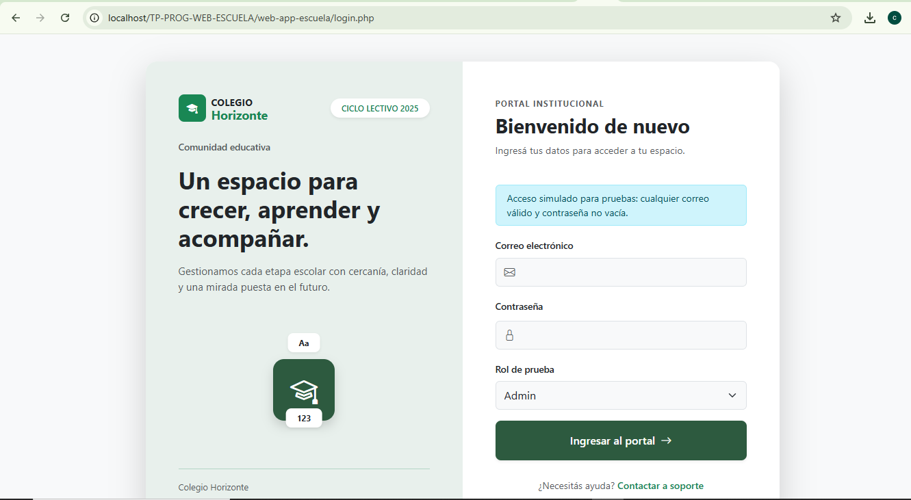

#### Estructura modular SSI

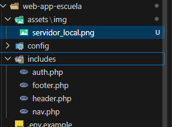

#### Navegación dinámica y títulos SSR

**Inicio**


**Cursos y niveles**

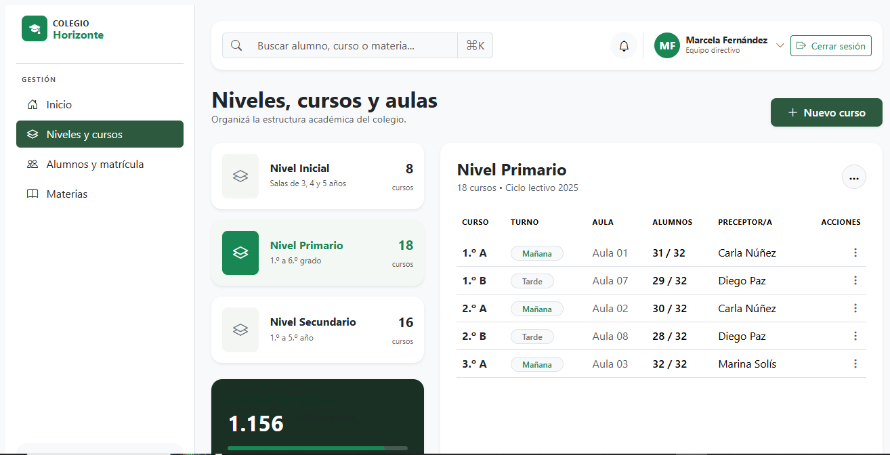

**Alumnos y matrícula**


#### Variables de entorno

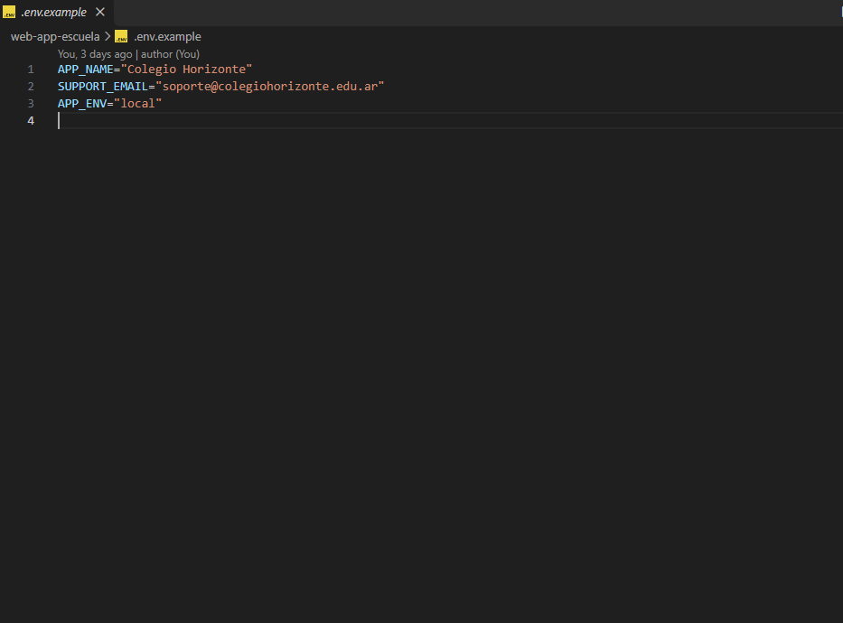

---

---

## Trabajo Práctico N.º 5: Procesamiento de Formularios y Seguridad Web

El quinto trabajo práctico incorpora la lógica del lado del servidor para capturar y procesar datos enviados desde el navegador. Todo el desarrollo de esta etapa se encuentra dentro de la carpeta exacta `clase5/` ubicada en `web-app-escuela/clase5/`.

Se implementaron dos interacciones de formulario cumpliendo con los requerimientos de seguridad web (OWASP Top 10 - XSS) y validación estricta.

### Formulario POST: Contacto / Consulta

Ubicado en `web-app-escuela/clase5/contacto.php`, es un formulario de contacto institucional que envía datos mediante el método POST.

- **Campos:** Nombre, Email, Asunto (lista desplegable) y Mensaje.
- **Validación en servidor:** Se comprueba que ningún campo requerido llegue vacío utilizando `isset()` y `empty()`. Se valida el formato del correo electrónico mediante `filter_var(..., FILTER_VALIDATE_EMAIL)`.
- **Sanitización:** Todos los datos recibidos pasan por `trim()` para eliminar espacios en blanco y `htmlspecialchars(..., ENT_QUOTES, 'UTF-8')` para prevenir inyecciones de scripts maliciosos (XSS).
- **Persistencia (Sticky Form):** Si ocurre un error de validación, los datos ingresados previamente se mantienen en el formulario para evitar que el usuario deba reescribirlos. Se logra a través de una función helper `c5_repoblar()`.
- **Mensajes:** Se muestran alertas de error (Bootstrap `alert-danger` e `is-invalid`) por cada campo y un mensaje general de éxito (`alert-success`).
- **Patrón PRG:** Se implementó el patrón Post/Redirect/Get para que al recargar la página tras un envío exitoso no se dupliquen los datos.

### Formulario GET: Buscador de Materias

Ubicado en `web-app-escuela/clase5/buscar.php`, es un buscador que filtra información mediante el método GET.

- **Campos:** Texto libre para materia (`q`), y listas desplegables para Nivel y Turno.
- **Sanitización GET:** Las variables capturadas por `$_GET` son sanitizadas antes de ser procesadas y renderizadas en la interfaz.
- **Lógica de búsqueda:** Se implementó un array estático simulando la base de datos de materias. Se utiliza `array_filter` con lógica de coincidencia por texto (usando `stripos`), nivel y turno.
- **Interfaz:** Los resultados coincidentes se muestran en una tabla (`table-striped`), respetando la seguridad al imprimir los datos. Si no hay resultados, se muestra una alerta (`alert-warning`).
- **Persistencia:** El formulario también mantiene los filtros seleccionados en pantalla tras realizar la búsqueda.

### Arquitectura de Clase 5

- `clase5/index.php`: Página central (hub) que da la bienvenida y enlaza a ambos formularios.
- `clase5/_bootstrap.php`: Inicializa la configuración, sesiones y la URL base (integrando los permisos del rol activo en el menú).
- `clase5/_helpers.php`: Funciones de soporte para sanitización de texto (`c5_sanitizar_texto`), emails (`c5_sanitizar_email`), repoblación (`c5_repoblar`) y manejo de mensajes flash (`c5_set_flash`, `c5_get_flash`).
- `clase5/contacto.php` y `clase5/buscar.php`: Vistas y controladores de los formularios POST y GET.

### Evidencias visuales del TP5

<details>
<summary>Capturas de pantalla de los formularios y validaciones</summary>

#### Hub de Clase 5
*Página principal del TP5 con acceso a ambos formularios.*


#### Formulario POST (Validación y Sticky Form)
*Muestra los errores de validación en rojo y cómo los datos se mantienen en pantalla.*

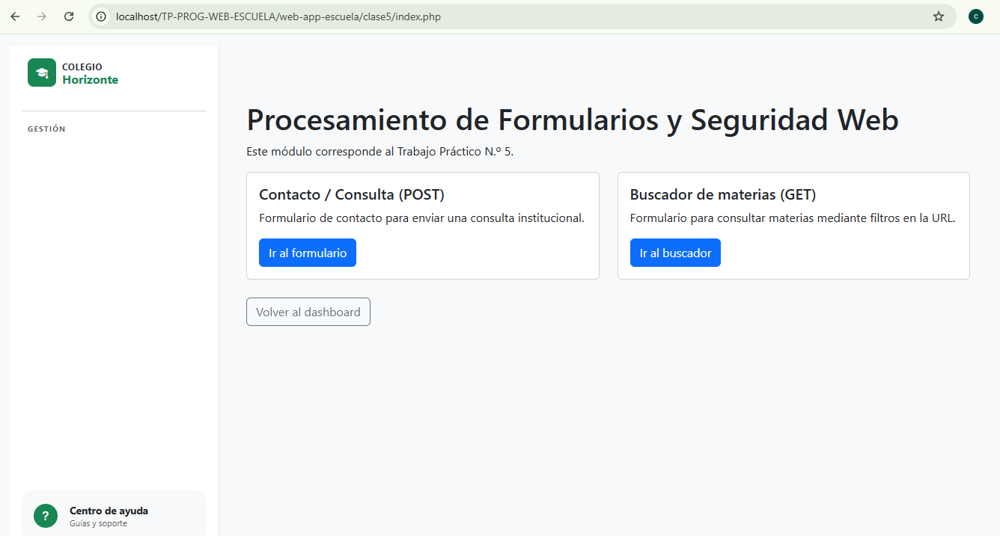

#### Formulario POST (Envío Exitoso)
*Alerta verde de confirmación tras el envío correcto (Patrón PRG).*

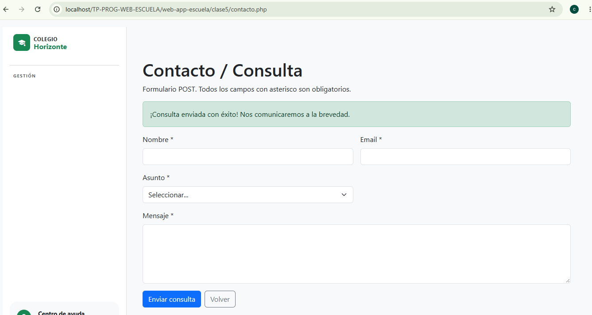

#### Seguridad XSS (Post y Get)
*El intento de inyección de `<script>` se muestra como texto plano y es bloqueado por `htmlspecialchars()`.*

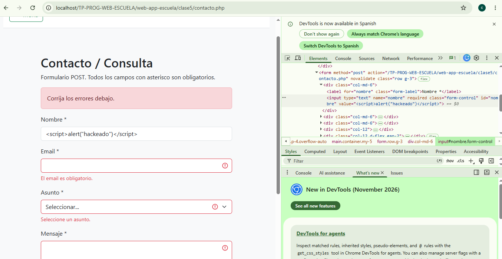

#### Formulario GET (Resultados de búsqueda)
*Tabla de resultados mostrando los filtros aplicados por la URL.*

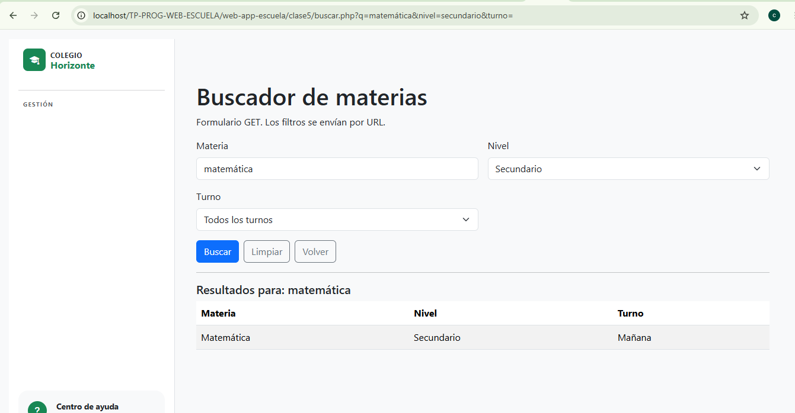

#### Formulario GET (Sin resultados)
*Mensaje de alerta cuando no hay coincidencias.*

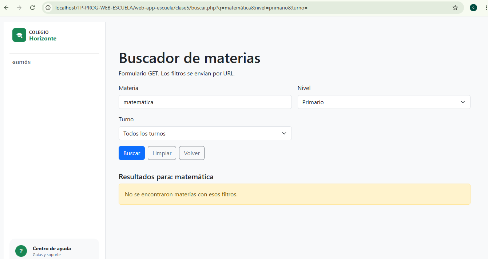

</details>


---

## Trabajo Práctico N.º 6: Diseño y Creación del Esquema Relacional en MySQL

El sexto trabajo práctico consistió en el diseño, normalización y creación de la base de datos relacional para el sistema escolar. Todo el desarrollo se encuentra en la carpeta `tp6/` en la raíz del repositorio.

### Normalización y Esquema (Parte 1 y 2)
Se documentó el proceso de normalización (1FN, 2FN y 3FN) en el archivo `tp6/NORMALIZACION.md`, partiendo de una tabla desnormalizada hasta llegar a un esquema relacional eficiente de 9 tablas.

El script DDL (`tp6/schema.sql`) crea la base de datos `colegio_horizonte` con las siguientes tablas:
- **Maestras:** `roles`, `niveles`, `materias`.
- **Principales:** `usuarios`, `alumnos`, `consultas_contacto`.
- **Relacionales:** `cursos`, `tutor_alumno` (relación N:M), `profesor_materia_curso` (relación N:M).

El script incluye claves primarias autoincrementales, integridad referencial (FOREIGN KEY), campos de auditoría (`created_at`, `updated_at`) y optimización mediante índices (`idx_usuarios_email`, `idx_alumnos_apellido`).

### Pruebas CRUD (Parte 3)
El archivo `tp6/consultas.sql` contiene las operaciones DML para validar el esquema:
- **Create:** Inserción de roles, niveles, cursos, un tutor (Lucía) con dos hijos (Emma y Tomás), y un profesor.
- **Read:** Consultas con `WHERE`, `ORDER BY` y un `INNER JOIN` para visualizar la relación Tutor-Alumno.
- **Update:** Modificación de datos de un usuario.
- **Delete:** Eliminación de un registro de prueba.

### Evidencias visuales del TP6

<details>
<summary>Capturas de pantalla de la base de datos y consultas</summary>

#### Estructura de la Base de Datos en phpMyAdmin
*Tablas creadas exitosamente en el motor MySQL.*

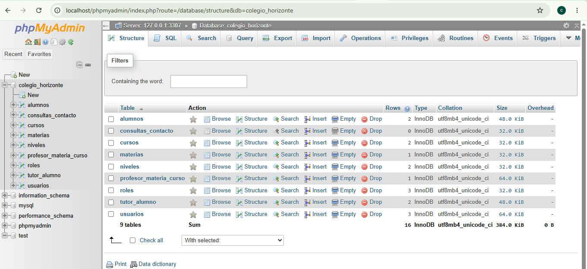

#### Resultado del INNER JOIN (Tutor - Alumno)
*Consulta SQL mostrando la relación entre el tutor y sus hijos.*

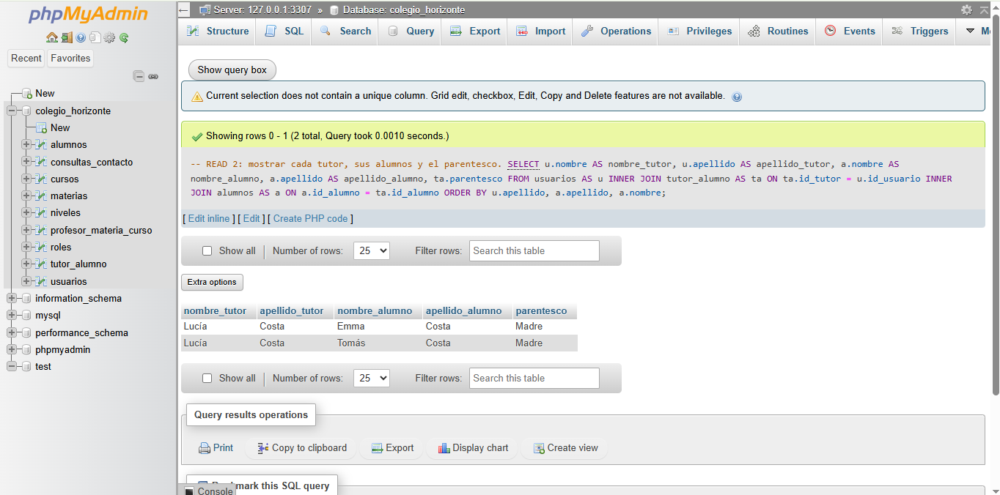

</details>


---

## Trabajo Práctico N.º 7: Persistencia y Conexión PHP-MySQL Segura

El séptimo trabajo práctico consistió en conectar la aplicación PHP con la base de datos relacional MySQL (diseñada en el TP6) utilizando **PDO** (PHP Data Objects). Se implementó un módulo CRUD completo para la gestión de alumnos, integrándolo visualmente con la maquetación institucional del sitio web.

### Conexión Segura y Arquitectura
- La conexión se gestiona a través de `config/conexion.php` utilizando PDO y manejo de excepciones mediante bloques `try-catch` (`PDOException`).
- Las credenciales de acceso (host, puerto, usuario, contraseña) están aisladas en el archivo `.env` y se cargan dinámicamente, evitando exponer datos sensibles en el código fuente.
- Se configuró explícitamente la conexión al puerto `3307` para apuntar al servidor MariaDB local de XAMPP.

### Módulo CRUD de Alumnos (Integración con la Maqueta)
El módulo se desarrolló en la carpeta `web-app-escuela/admin/` y se integró al menú de navegación principal. Utiliza la misma estructura visual (Bootstrap 5, header, sidebar) que el resto de la aplicación:
- **Read (index.php):** Listado de alumnos con `LEFT JOIN` a la tabla de cursos. Incluye un buscador funcional por nombre/apellido con filtros aplicados directamente en la base de datos.
- **Create (crear.php):** Formulario de alta de alumnos con validaciones en el servidor.
- **Update (editar.php):** Formulario de edición que precarga los datos actuales del alumno desde MySQL.
- **Delete (eliminar.php):** Lógica de baja con validación estricta del ID recibido por GET.

### Seguridad Aplicada (OWASP)
- **Prevención de Inyección SQL:** Uso estricto de **Consultas Preparadas** (Prepared Statements) con marcadores de posición (`:parametros`) en todas las operaciones de lectura y escritura.
- **Prevención de XSS:** Todos los datos provenientes de la base de datos son sanitizados en las vistas utilizando `htmlspecialchars()`.
- **Validación de Entradas:** Uso de `filter_var()` con `FILTER_VALIDATE_INT` para validar los IDs antes de procesar actualizaciones o eliminaciones.

### Evidencias visuales del TP7

<details>
<summary>Capturas de pantalla del CRUD integrado y la persistencia</summary>

#### Listado de Alumnos con Buscador (Read)
*Tabla conectada a MySQL con diseño unificado al sitio y buscador en tiempo real.*

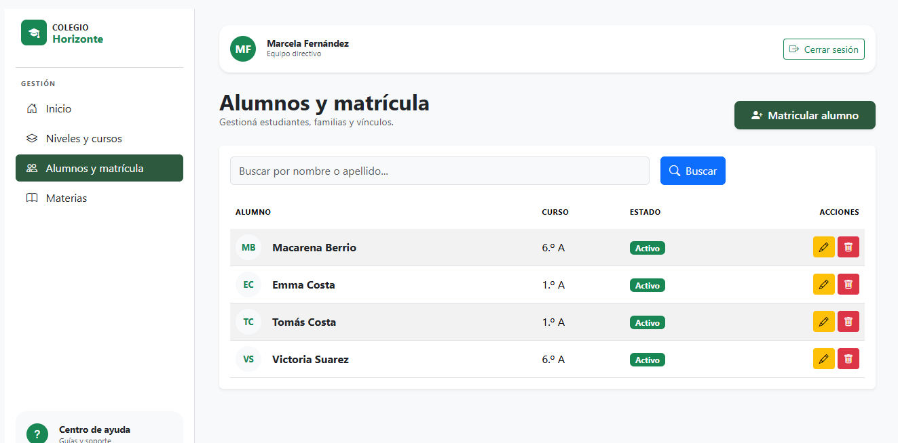

#### Formulario de Alta (Create)
*Inserción de un nuevo alumno con validaciones.*

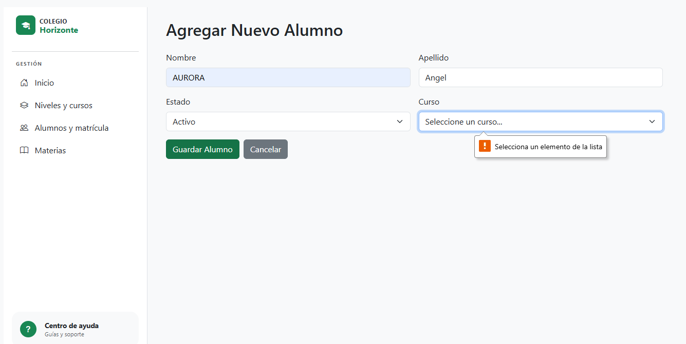

#### Formulario de Edición (Update)
*Precarga de datos existentes desde la base de datos.*

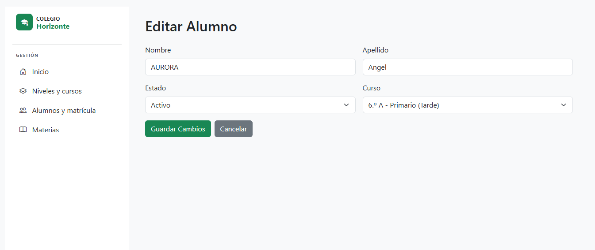

</details>

---

## Trabajo Práctico N.º 8: Manejo de Estado, Sesiones y Autenticación

El octavo trabajo práctico implementa el módulo completo de autenticación sobre la base de datos del TP6: registro de cuentas con contraseñas encriptadas, inicio de sesión real verificado contra MySQL, protección de rutas reutilizable y control de acceso por roles. Todo el desarrollo se encuentra en `web-app-escuela/`.

### Módulos implementados

<details>
<summary><code>registro.php</code> — Registro de usuarios</summary>

Formulario con Nombre, Apellido, Email, Contraseña y Repetir Contraseña, con validación en el servidor:

- Campos vacíos, formato de email con `filter_var(..., FILTER_VALIDATE_EMAIL)` y coincidencia de contraseñas.
- Consulta preparada que verifica que el email no esté registrado previamente.
- Contraseña encriptada con `password_hash($password, PASSWORD_BCRYPT)` e inserción mediante **PDO con consultas preparadas** en la tabla `usuarios` (columna `password_hash`), asignando el rol **Tutor (`id_rol = 3`)**.
- Redirección a `login.php` dejando el mensaje de éxito en `$_SESSION['registro_exitoso']`, que se muestra una sola vez y se borra después.
- "Sticky form": ante un error los campos se repueblan con `htmlspecialchars()`; las contraseñas nunca se repueblan.

</details>

<details>
<summary><code>login.php</code> — Inicio de sesión real</summary>

Se eliminó el select de roles simulado del TP4:

- Busca al usuario por email con un `INNER JOIN` entre `usuarios` y `roles` para traer el nombre del rol, y comprueba la contraseña con `password_verify()`.
- Un mensaje genérico ("Correo o contraseña incorrectos.") evita revelar si el correo existe (enumeración de usuarios).
- Si es correcto: `session_regenerate_id(true)` **antes** de guardar los datos (prevención de fijación de sesión) y luego `$_SESSION['usuario_id']`, `$_SESSION['usuario_nombre']` y `$_SESSION['rol']`, con redirección a `dashboard.php`.
- Muestra el mensaje `$_SESSION['registro_exitoso']` dejado por el registro y lo borra después de mostrarlo.
- Incluye el enlace "¿No tenés cuenta? Regístrate acá".

</details>

<details>
<summary><code>auth_guard.php</code> — Protección de rutas reutilizable</summary>

Script único incluido en cada vista protegida, siempre antes de cualquier salida HTML:

```php
$requerirPermiso = 'alumnos';
require_once __DIR__ . '/auth_guard.php';
```

- Inicia la sesión, valida que `$_SESSION['rol']` exista en `config/roles.php` y deja listo `$currentUser`.
- Si la sesión no es válida: vacía `$_SESSION`, ejecuta `session_destroy()` y redirige a `login.php` con ruta absoluta (funciona igual desde `admin/`, evitando el 404 del redirect relativo).
- **Control de acceso por roles:** responde `403` cuando el rol no tiene el permiso requerido.
- Reemplaza el chequeo duplicado que existía en los cuatro archivos de `admin/`.

</details>

<details>
<summary><code>logout.php</code> — Cierre de sesión</summary>

- `session_unset()` para vaciar el array `$_SESSION`.
- `session_destroy()` para destruir los datos de la sesión en el servidor.
- `setcookie(..., time() - 42000, ...)` para eliminar la cookie de sesión del navegador.
- Redirección a `login.php`.

</details>

### Matriz de pruebas de seguridad

<details>
<summary>Resultados por rol al acceder directo a las URLs</summary>

| Rol | `dashboard.php` | `hijos.php` | `materias.php` | `niveles.php` | `admin/index.php` |
|---|---|---|---|---|---|
| **Admin** | ✅ Acceso | 403 | ✅ Acceso | ✅ Acceso | ✅ Acceso |
| **Tutor** | ✅ Acceso | ✅ Acceso | 403 | 403 | **403** |
| **Profesor** | ✅ Acceso | 403 | ✅ Acceso | 403 | **403** |
| **Sin sesión** | → login | → login | → login | → login | → login |

También se verificó:

- El acceso sin sesión a `admin/index.php` redirige a `login.php` (antes el redirect relativo resolvía a `/admin/login.php` y daba **404**).
- `session_regenerate_id(true)` se ejecuta antes de escribir en `$_SESSION`.
- `logout.php` cumple los tres pasos: vaciar `$_SESSION`, destruir la cookie y `session_destroy()`.
- Un ciclo completo de CRUD (alta y baja de alumno) funciona con el guard activo.
- `php -l` sin errores en los 11 archivos modificados.

</details>

### Evidencias visuales del TP8

<details>
<summary>Capturas de pantalla</summary>

#### Login real
*Formulario de acceso sin el select de roles simulado del TP4, con el enlace "¿No tenés cuenta? Regístrate acá" debajo del botón "Ingresar al portal".*

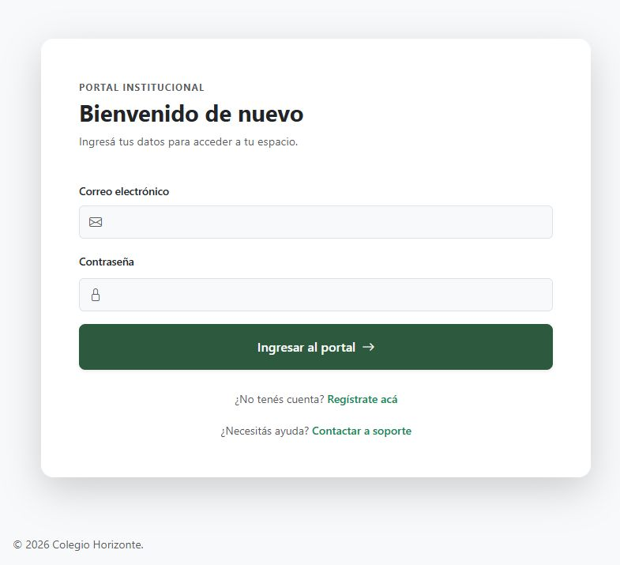

#### Dashboard por rol
*Panel visto con el rol **Tutor**: saludo personalizado, tarjetas de indicadores y menú lateral filtrado por permisos (sólo "Inicio" e "Mis Hijos").*

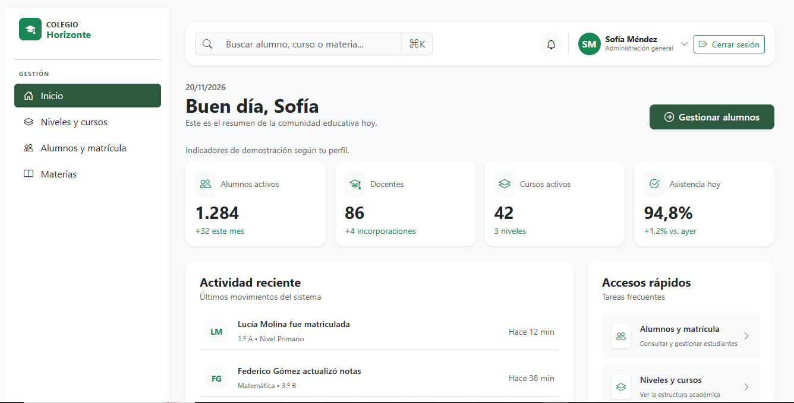
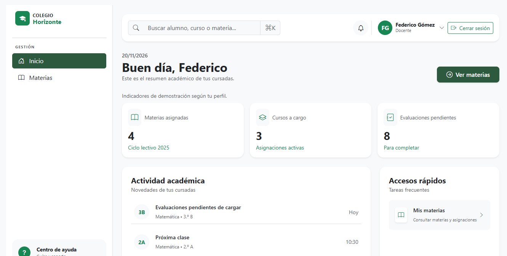
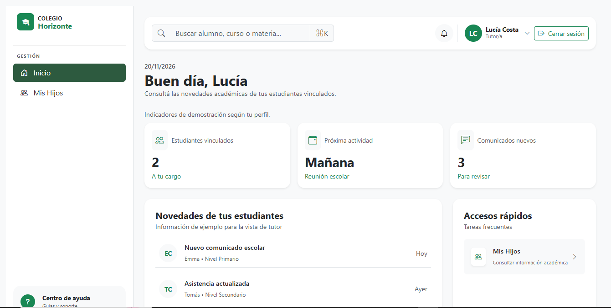

#### Error 403 por control de acceso
*Sesión iniciada como **Tutor** intentando entrar a "Alumnos y matrícula" (`admin/index.php`): `auth_guard.php` responde "No tenés permiso para acceder a esta sección." en lugar de mostrar el listado.*

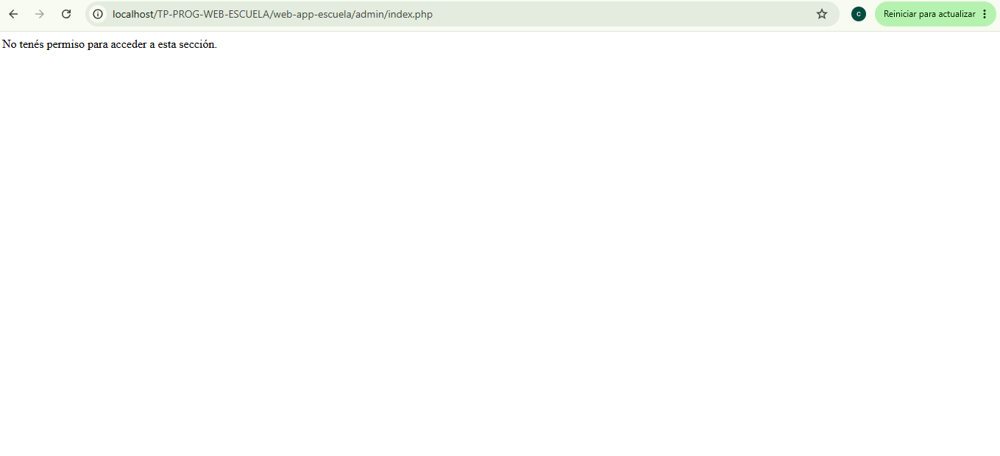

#### Cierre de sesión
*Barra superior del dashboard con el botón verde "Cerrar sesión" (esquina superior derecha, junto al perfil del usuario). Al pulsarlo, `logout.php` vacía `$_SESSION`, borra la cookie y destruye la sesión, y el sitio vuelve al formulario de acceso.*

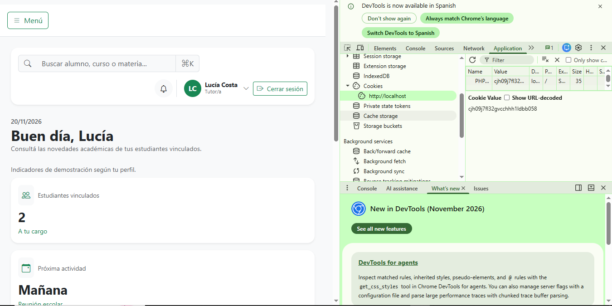
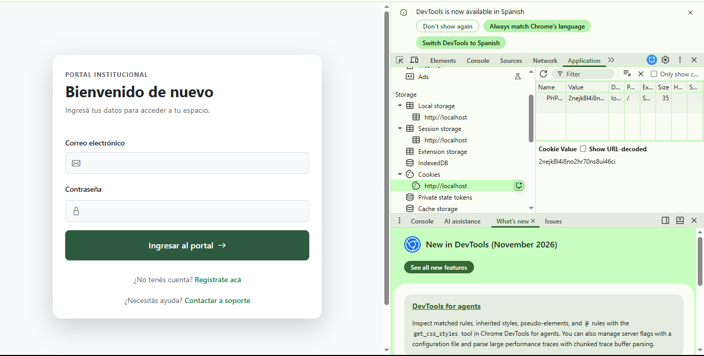

</details>


## Datos finales

- **Alumno:** Cristian Fernando Barrios
- **Carrera:** Tecnicatura Superior en Desarrollo de Software
- **Materia:** Programación Web
- **Profesor:** Lic. Gabriel Artaza
- **Tema:** Colegio Horizonte
